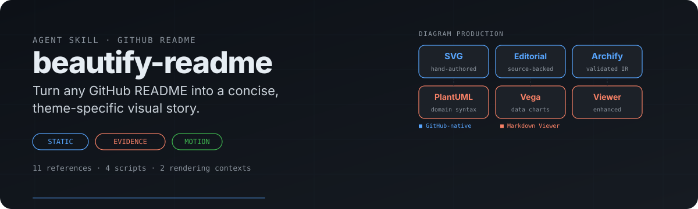

<p align="center">
  
</p>

# beautify-readme

An agent skill that turns any GitHub README into a concise, theme-specific visual story. It combines README content architecture, hand-authored SVG, source-backed editorial static diagrams, structured diagram engines, optional [Archify](https://github.com/tt-a1i/archify) system maps, and optional motion — supporting both GitHub-native rendering and Markdown Viewer enhanced diagrams.

[简体中文](./README.zh-CN.md)

## What it does

- **README mode** — restructure the story, build a visual system, and produce a cohesive homepage.
- **Asset-only mode** — create individual SVG heroes, section headers, diagrams, badges, or motion graphics without touching the README.
- **Dual rendering context** — GitHub-native SVG/PNG/GIF for `github.com`, plus code-fence diagrams (PlantUML, Vega, infographic, canvas, architecture, infocard) for Markdown Viewer extensions.
- **Editorial static code diagrams** — GitHub-native flowcharts, dependency maps, class/ER/database diagrams, trees, timelines, and swimlanes with source evidence and a fidelity manifest.
- **Code stats badges** — code size and lines-of-code badges from shields.io, with a GitHub Actions workflow that keeps the line count current.
- **Optional Archify maps** — validated architecture / workflow / sequence / dataflow / lifecycle diagrams checked by Archify 3.x `finalize`, then exported as static SVG/PNG for GitHub-native embeds.

## How it works: from request to verified asset

<p align="center">
  
</p>

Repository facts come first, visual decisions are frozen before drawing, and nothing ships until the verify gate passes — a failure loops back to the build step. The diagram was drawn with Archify 3.x from a [typed workflow IR](./assets/readme/source/how-it-works.archify.json) whose nodes cite line ranges in `SKILL.md`.

## Choose a production path

| Engine | Use it for | Output | Renders on |
| --- | --- | --- | --- |
| Hand SVG | Heroes, section headers, badges | `.svg` | GitHub |
| Editorial-static | Code logic, dependencies, class / ER / database, trees, timelines, swimlanes | SVG/PNG + evidence manifest | GitHub |
| Archify | Runtime architecture, workflows, sequences, dataflow, lifecycles | exported SVG/PNG + JSON IR | GitHub |
| PlantUML | UML, cloud, network, BPMN, ArchiMate | ` ```plantuml ` | Both |
| Vega / Vega-Lite | Data charts, radar, word clouds | ` ```vega-lite ` / ` ```vega ` | Both |
| Infographic, Canvas, Architecture, Infocard | KPI dashboards, concept maps, editable HTML architecture, info cards | code fence or direct HTML | Viewer |

GitHub-native assets go to `assets/readme/diagrams/` with their source under `assets/readme/source/`; Viewer-only fences go straight into the README. Archify is optional (`tt-a1i/archify`) — without it, the skill falls back to editorial-static, PlantUML, or hand SVG.

## Installation

### Quick install

```bash
cp -r skills/beautify-readme ~/.qoder/skills/
```

### Manual

Copy the `skills/beautify-readme/` directory into your agent's skills folder:

| Agent | Path |
| --- | --- |
| Qoder | `~/.qoder/skills/` |
| Claude Code | `~/.claude/skills/` |
| Cursor | `~/.cursor/skills/` |

## Usage

```
Use $beautify-readme to redesign this repository homepage around its developer-tool theme.
```

```
Use $beautify-readme to create one SVG hero and three section headers without modifying the README.
```

```
Use $beautify-readme to add a PlantUML architecture diagram and a Vega-Lite benchmark chart to this README.
```

```
Use $beautify-readme to inspect this repository and add a GitHub-native request flow with source evidence.
```

```
Use $beautify-readme to add a GitHub-native How it works diagram via Archify and export the diagram SVG.
```

```
Use $beautify-readme to create a hybrid hero: SVG typography and layout, plus an ImageGen character cutout.
```

## Skill structure

```
skills/beautify-readme/
├── SKILL.md                          # Main skill: workflow, modes, quality bar
├── references/
│   ├── content-architecture.md       # README content sequencing and editing rules
│   ├── readme-canvas.md              # GitHub README canvas constraints
│   ├── svg-production.md             # Hand-authored SVG production rules
│   ├── visual-direction.md           # Theme-specific visual direction
│   ├── design-system.md              # Consolidated design rules (color, type, taste)
│   ├── project-native-hero.md        # Hero design from project content
│   ├── hybrid-svg-production.md      # Hybrid SVG + raster composition
│   ├── motion-production.md          # GitHub-safe GIF animation
│   ├── editorial-static-diagrams.md  # Source-backed GitHub-native code diagrams
│   ├── diagram-engines.md            # Engine catalog + optional Archify branch + syntax rules
│   └── output-verification.md        # Mandatory compliance gate (4 dimensions)
└── scripts/
    ├── audit_readme.py               # Audit README image references and SVG basics
    ├── verify_readme.py              # Programmatic compliance checker (4 dimensions)
    ├── test_verify_readme.py         # Verifier tests (editorial-static, Archify)
    └── render_motion_gif.py          # Render GitHub-safe GIF from SVG + motion spec
```

## Quality bar

- The design looks native to the project, not to this skill.
- The hero's visual material comes from the project — not generic decoration.
- Real proof appears before abstract claims.
- The README becomes shorter or clearer, not merely more decorated.
- Removing the repository name should not make the hero reusable for an unrelated project.
- Every visual module has a communication job.
- Design choices pass a taste checklist: no centered-only heroes, no equal-width tiles, no pure black, no neon gradients, no AI filler phrasing.

## Limitations

- Code-fence diagrams (PlantUML, Vega, infographic, canvas, architecture, infocard) require a Markdown Viewer extension — they render as raw code on `github.com` unless exported to static images.
- Editorial-static diagrams rely on Agent code inspection rather than automatic program analysis; manifests make evidence auditable but cannot prove behavioral completeness.
- Archify system maps require the external `tt-a1i/archify` skill (3.x) and Node.js. Static SVG/PNG comes from the checked HTML's Export menu, so a browser step is needed; GitHub embeds must use that export, not interactive HTML alone.
- GIF motion is opt-in and size-constrained; GitHub does not autoplay GIFs on mobile.
- The skill does not generate raster photos or illustrations — use the `imagegen` skill for that and compose via hybrid SVG production.
- The audit and verification scripts check structural compliance, not aesthetic judgment — manual visual review is still required.

## Contributors

<p align="center">
  Thanks to everyone building this skill.
</p>

<p align="center">
  <a href="https://github.com/HuangChenning/beautify-readme/graphs/contributors">
    
  </a>
</p>

### Contribution stats

<!-- CONTRIBUTORS:START -->
| Contributor | Commits | Lines added | Lines removed |
| --- | ---: | ---: | ---: |
| HuangChenning | 7 | +4,101 | −51 |
| Huangcn | 4 | +1,278 | −141 |
<!-- CONTRIBUTORS:END -->

<sub>Generated from <code>git shortlog</code> and <code>git log --shortstat</code> (merge commits excluded). Refresh with <code>python3 scripts/update_contributors.py</code> whenever this README changes.</sub>

## License

MIT
