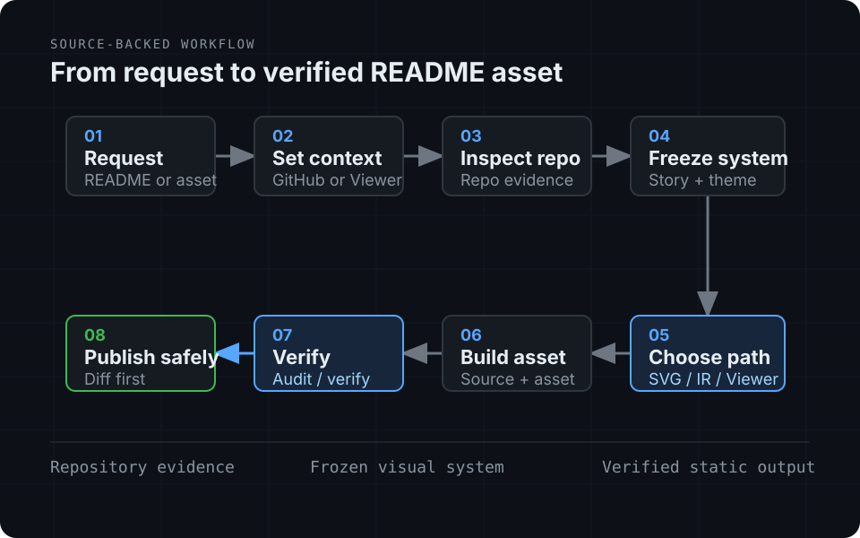

<p align="center">
  
</p>

# beautify-readme

An agent skill that turns any GitHub README into a concise, theme-specific visual story. It combines README content architecture, hand-authored SVG, source-backed editorial static diagrams, structured diagram engines, optional [Archify](https://github.com/tt-a1i/archify) system maps, and optional motion — supporting both GitHub-native rendering and Markdown Viewer enhanced diagrams.

[简体中文](./README.zh-CN.md)

## What it does

- **README mode** — restructure the story, build a visual system, and produce a cohesive homepage.
- **Asset-only mode** — create individual SVG heroes, section headers, diagrams, badges, or motion graphics without touching the README.
- **Dual rendering context** — GitHub-native SVG/PNG/GIF for `github.com`, plus code-fence diagrams (PlantUML, Vega, infographic, canvas, architecture, infocard) for Markdown Viewer extensions.
- **Editorial static code diagrams** — GitHub-native flowcharts, dependency maps, class/ER/database diagrams, trees, timelines, and swimlanes with source evidence and a fidelity manifest.
- **Code stats badges** — code size and lines-of-code badges from shields.io, with a GitHub Actions workflow that keeps the line count current.
- **Optional Archify maps** — validated architecture / workflow / sequence / dataflow / lifecycle diagrams exported as Share Cards for GitHub-native embeds.

## How it works: from request to verified asset

<p align="center">
  
</p>

The diagram is itself produced through the new editorial-static contract: a GitHub-safe SVG backed by a [source-evidence and fidelity manifest](./assets/readme/source/readme-production-flow.diagram.json). Repository facts come first, visual decisions are frozen before drawing, and validation happens before handoff.

## Choose a production path

| Need | Engine | Code fence / output | Context |
| --- | --- | --- | --- |
| Code branches and decision logic | Editorial-static | SVG/PNG + evidence manifest | GitHub-native |
| Dependencies, class/ER/database structure | Editorial-static | SVG/PNG + evidence manifest | GitHub-native |
| Repository hierarchy, timeline, or handoffs | Editorial-static | SVG/PNG + evidence manifest | GitHub-native |
| Polished runtime / service architecture | Archify | PNG/SVG Share Card | GitHub-native |
| CI/CD, approvals, tool-call workflows | Archify | PNG/SVG Share Card | GitHub-native |
| API / cache / auth traces; dataflow; lifecycle | Archify | PNG/SVG Share Card | GitHub-native |
| Software modeling (class, sequence, activity, state) | PlantUML | ` ```plantuml ` | Both |
| Cloud architecture (AWS, Azure, GCP, K8s) | PlantUML | ` ```plantuml ` | Both |
| Network / security / IoT / BPMN / ArchiMate | PlantUML | ` ```plantuml ` | Both |
| Data charts (bar, line, scatter, heatmap) | Vega-Lite | ` ```vega-lite ` | Both |
| Advanced charts (radar, word cloud) | Vega | ` ```vega ` | Both |
| KPI dashboard, timeline, SWOT, funnel | Infographic | ` ```infographic ` | Viewer |
| Concept map, knowledge graph | Canvas (JSON) | ` ```canvas ` | Viewer |
| Layered system architecture (editable HTML) | Architecture | direct HTML | Viewer |
| Editorial information cards | Infocard | direct HTML | Viewer |

For GitHub-native code diagrams, editorial-static freezes type, format, size, detail, and audience; publishes under `assets/readme/diagrams/`; and retains source evidence plus the fidelity ledger under `assets/readme/source/`. For Markdown Viewer context, write the code fence directly in the README. Archify is an optional external skill (`tt-a1i/archify`); when unavailable, fall back to editorial-static, PlantUML, Architecture HTML, or hand-authored SVG.

## Installation

### Quick install

```bash
cp -r skills/beautify-readme ~/.qoder/skills/
```

### Manual

Copy the `skills/beautify-readme/` directory into your agent's skills folder:

| Agent | Path |
| --- | --- |
| Qoder | `~/.qoder/skills/` |
| Claude Code | `~/.claude/skills/` |
| Cursor | `~/.cursor/skills/` |

## Usage

```
Use $beautify-readme to redesign this repository homepage around its developer-tool theme.
```

```
Use $beautify-readme to create one SVG hero and three section headers without modifying the README.
```

```
Use $beautify-readme to add a PlantUML architecture diagram and a Vega-Lite benchmark chart to this README.
```

```
Use $beautify-readme to inspect this repository and add a GitHub-native request flow with source evidence.
```

```
Use $beautify-readme to add a GitHub-native How it works diagram via Archify and export a Share Card PNG.
```

```
Use $beautify-readme to create a hybrid hero: SVG typography and layout, plus an ImageGen character cutout.
```

## Skill structure

```
skills/beautify-readme/
├── SKILL.md                          # Main skill: workflow, modes, quality bar
├── references/
│   ├── content-architecture.md       # README content sequencing and editing rules
│   ├── readme-canvas.md              # GitHub README canvas constraints
│   ├── svg-production.md             # Hand-authored SVG production rules
│   ├── visual-direction.md           # Theme-specific visual direction
│   ├── design-system.md              # Consolidated design rules (color, type, taste)
│   ├── project-native-hero.md        # Hero design from project content
│   ├── hybrid-svg-production.md      # Hybrid SVG + raster composition
│   ├── motion-production.md          # GitHub-safe GIF animation
│   ├── editorial-static-diagrams.md  # Source-backed GitHub-native code diagrams
│   ├── diagram-engines.md            # Engine catalog + optional Archify branch + syntax rules
│   └── output-verification.md        # Mandatory compliance gate (4 dimensions)
└── scripts/
    ├── audit_readme.py               # Audit README image references and SVG basics
    ├── verify_readme.py              # Programmatic compliance checker (4 dimensions)
    ├── test_verify_readme.py         # Editorial-static verification tests
    └── render_motion_gif.py          # Render GitHub-safe GIF from SVG + motion spec
```

## Quality bar

- The design looks native to the project, not to this skill.
- The hero's visual material comes from the project — not generic decoration.
- Real proof appears before abstract claims.
- The README becomes shorter or clearer, not merely more decorated.
- Removing the repository name should not make the hero reusable for an unrelated project.
- Every visual module has a communication job.
- Design choices pass a taste checklist: no centered-only heroes, no equal-width tiles, no pure black, no neon gradients, no AI filler phrasing.

## Limitations

- Code-fence diagrams (PlantUML, Vega, infographic, canvas, architecture, infocard) require a Markdown Viewer extension — they render as raw code on `github.com` unless exported to static images.
- Editorial-static diagrams rely on Agent code inspection rather than automatic program analysis; manifests make evidence auditable but cannot prove behavioral completeness.
- Archify system maps require the external `tt-a1i/archify` skill and Node.js; GitHub embeds must use exported PNG/SVG, not interactive HTML alone.
- GIF motion is opt-in and size-constrained; GitHub does not autoplay GIFs on mobile.
- The skill does not generate raster photos or illustrations — use the `imagegen` skill for that and compose via hybrid SVG production.
- The audit and verification scripts check structural compliance, not aesthetic judgment — manual visual review is still required.

## Contributors

<p align="center">
  Thanks to everyone building this skill.
</p>

<p align="center">
  <a href="https://github.com/HuangChenning/beautify-readme/graphs/contributors">
    
  </a>
</p>

### Contribution stats

<!-- CONTRIBUTORS:START -->
| Contributor | Commits | Lines added | Lines removed |
| --- | ---: | ---: | ---: |
| HuangChenning | 7 | +4,101 | −51 |
| Huangcn | 1 | +63 | −0 |
<!-- CONTRIBUTORS:END -->

<sub>Generated from <code>git shortlog</code> and <code>git log --shortstat</code> (merge commits excluded). Refresh with <code>python3 scripts/update_contributors.py</code> whenever this README changes.</sub>

## License

MIT
